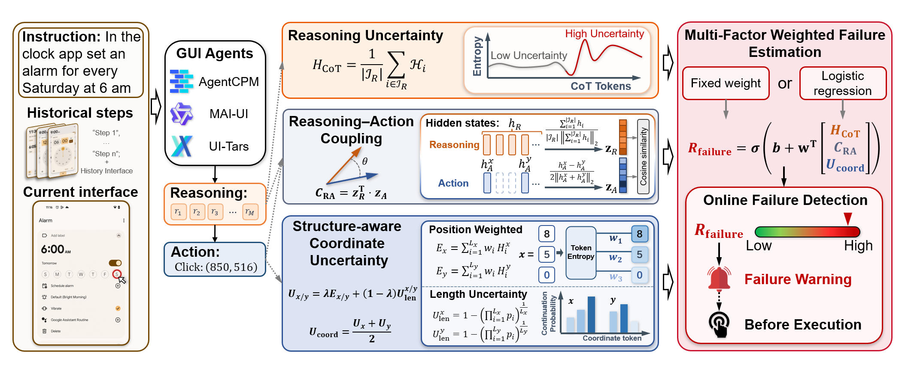

# GUI Failure Monitoring

[English](readme.md) | [简体中文](readme_zh.md)

Inference code for **What Makes a Wrong Click? An Empirical Analysis of Decision Reliability and Failure Detection in GUI Agents**.



Given an instruction, screenshot and optional interaction history, the code
generates an action and measures three internal signals before execution:
reasoning entropy (`H_CoT`), structure-aware coordinate uncertainty (`U_coord`),
and reasoning–action representation coupling (`C_RA`). A frozen fixed-weight
or logistic fusion model can combine them into a click-failure risk score.

Supported agents are **AgentCPM-GUI-8B**, **MAI-UI-8B**, and **UI-TARS-1.5-7B**.
The main benchmark directory mappings cover CMGUI, CAGUI, AC-High and
GUIOdyssey. AITZ and AC-Low remain optional inputs.

This release provides a runnable inference implementation of the method. It
does not distribute datasets, model weights or fitted
logistic coefficients. See [method and implementation choices](docs/METHOD.md) for entropy units, native UI-TARS coordinates and history settings inherited from the
original scripts.

## Layout

```text
gui_failure/
  backends.py          local model loading, prompts and generation
  signals.py           three signals from one decoding trace
  parsing.py           strict native reasoning/click spans
  data.py              prepared episode loading
  actions.py           previous-action format conversion
  cmgui.py             official CMGUI test annotation conversion
  parallel.py          one replica per GPU and prediction shard merging
  fusion.py            frozen scaler and fixed/logistic fusion
  evaluation.py        legacy-compatible AgentCPM/MAI action evaluation
  cli.py               shared command-line interface
  resources/           model prompts and AgentCPM action schema
eval/
  scripts_gui/run_inference.py   direct-script inference entry
  eval_data/                    preparation instructions/scripts; data stays local
requirements/                   model environments, optional evaluation/fusion
docs/                           environment, data and method details
tests/                          synthetic numerical and integration checks
```

## 1. Configure a model environment

Use Python 3.11 and **separate environments**. The version pins come from the
author's actual environments and the official model projects. Full CUDA setup,
checkpoint downloads and upstream links are in [ENVIRONMENT.md](docs/ENVIRONMENT.md).

AgentCPM:

```bash
conda create -n gui_agent python=3.11 -y
conda activate gui_agent
python -m pip install torch==2.5.1 torchvision==0.20.1 --index-url https://download.pytorch.org/whl/cu121
python -m pip install -r requirements/agentcpm.txt
python -m pip install -e .
```

MAI-UI / UI-TARS:

```bash
conda create -n mai python=3.11 -y
conda activate mai
python -m pip install torch==2.8.0 torchvision==0.23.0 --index-url https://download.pytorch.org/whl/cu128
python -m pip install -r requirements/mai-tars.txt
python -m pip install -e .
```

Run these commands from the repository root. After installation,
`gui-failure` and `python -m gui_failure` are equivalent. Direct script execution
is also available via `python eval/scripts_gui/run_inference.py --help`.
If a matching model environment already exists, activate it instead of
recreating it.

The shared entry point is `gui_failure/cli.py:main`, invoked by
`python -m gui_failure` through `gui_failure/__main__.py`. Its subcommands are
`check-data`, `infer`, `evaluate`, `fit-fusion`, and `score`. To inspect inference options:

```bash
python -m gui_failure infer --help
```

`eval/scripts_gui/run_inference.py` calls the same entry point with the `infer`
subcommand already selected. All runtime helpers are inside `gui_failure/`;
the separate original AgentCPM checkout's root `utils.py` is not a dependency.

AgentCPM uses the provided `MiniCPMVTokenizerFast`; do not force its processor
to `use_fast=False`. See [environment notes](docs/ENVIRONMENT.md#agentcpm-gui)
if loading reports a missing `tokenization_qwen2.py`.

## 2. Prepare inputs

Follow [eval/eval_data/readme.md](eval/eval_data/readme.md) for source datasets
and [DATA.md](docs/DATA.md) for the exact prepared episode schema. The project
expects the existing dataset placement convention; no dataset upload is needed.
For interrupted CMGUI downloads, see the [download troubleshooting notes](eval/eval_data/readme.md#download-troubleshooting-xet-errors-and-http-timeouts).
To check paths without loading a model:

```bash
python -m gui_failure check-data --data-name cmgui_test --max-samples 10
```

Supply `--data-root /path/to/eval_data` if data is outside this checkout. A
single screenshot needs no dataset preparation; see the next example.

## 3. Generate actions and signals

With the matching environment active and checkpoint downloaded:

```bash
# AgentCPM: one screenshot, no history
python -m gui_failure infer --backend agentcpm --model-path model/AgentCPM-GUI \
  --image /path/to/screen.png --instruction 'Open Settings' \
  --history-n 0 --output results/agentcpm/single.jsonl

# AgentCPM: a small prepared CMGUI run
python -m gui_failure infer --backend agentcpm --model-path model/AgentCPM-GUI \
  --data-name cmgui_test --max-samples 10 --output results/agentcpm/cmgui.jsonl

# MAI-UI: AC-High
python -m gui_failure infer --backend maiui --model-path model/MAI-UI-8B \
  --data-name android_control_high_test --max-samples 10 \
  --output results/maiui/ac_high.jsonl

# UI-TARS: GUIOdyssey
python -m gui_failure infer --backend tars --model-path model/UI-TARS-1.5-7B \
  --data-name gui_odyssey_test --max-samples 10 --output results/tars/odyssey.jsonl
```

Remove `--max-samples` to process the complete selected split. Run one backend
and dataset per command; choose another `--data-name` to process CAGUI or other
benchmarks. `--model-path` accepts a local path or Hugging Face ID; omitting it
uses the official ID. Use `--local-files-only` for an offline local checkpoint.
Models already in the Hugging Face cache do not need to be copied into
`model/`. Pass the official model ID with `--model-path` (or omit that option
for the chosen backend's default ID). With `--local-files-only`, the loader
resolves the cached snapshot directory first, including processor components,
so missing cache entries fail without starting a download. Use the `mai`
environment for MAI-UI and UI-TARS.

The default device is `cuda:0` and the default CUDA dtype is bfloat16.
Each process loads one model on one GPU. Use `--device` for a single process,
or `--devices cuda:0,cuda:1,cuda:2,cuda:3` to distribute a dataset across four
model replicas. `CUDA_VISIBLE_DEVICES` controls which physical GPUs the process
can see; listed device indices are relative to that visible set.

AgentCPM samples by default (`temperature=0.1`, `top_p=0.3`); MAI-UI and
UI-TARS use greedy decoding by default. Explicitly pass `--do-sample`
(`--do_sample`) to enable sampling, or `--no-sample` (`--no_sample`) to disable
it for any backend. Sampling parameters can be set with `--temperature`,
`--top-p`, `--top-k`, and `--seed`; `--max-new-tokens` sets the output limit.
`--history-n 3` retains all previous action/thought text and up to two earlier
screenshots. Use `--history-steps 3` to additionally cap text history to three
previous steps; `--history-n 0` removes history completely. These controls are
explained in [METHOD.md](docs/METHOD.md).

Output JSONL contains one record per input step, including non-click outputs:

```json
{
  "sample_id": "cmgui_test/cmgui/episode_001/0",
  "generated_text": "...",
  "action": {"thought": "...", "POINT": [600, 300]},
  "point_native": [600, 300],
  "point_1000": [600, 300],
  "is_valid_click": true,
  "signals": {"H_CoT": 0.8, "U_coord": 0.12, "C_RA": 0.65},
  "signal_errors": {},
  "signal_config": {"backend": "agentcpm", "alpha": 1.0, "digit_weight": 0.7, "coordinate_entropy_unit": "normalized"}
}
```

The numbers above illustrate the schema; they are not experimental results.
Additional fields record coordinate components, generation length, image size,
IDs and seeds. Missing signals are `null` with explicit `signal_errors`.
Scores are derived without reading the current reference action or correctness
label. Inference saves package versions and run settings beside the output as
`<output>.meta.json`. In multi-GPU runs, package versions are recorded in
each worker's metadata under `predict.shards/` (or `<output-stem>.shards/`
when using `--output`).

For multi-GPU runs, the output directory contains:

| File | Purpose |
| --- | --- |
| `predict.jsonl` | Final predictions merged in dataset order, one record per step; published after all workers succeed |
| `predict.jsonl.meta.json` | Global run arguments, GPU assignments and worker-file locations; used to validate resume settings |
| `predict.shards/worker-NNN.jsonl` | Predictions for one disjoint sample shard |
| `predict.shards/worker-NNN.jsonl.meta.json` | That worker's device, shard settings, Python and package versions |
| `predict.shards/worker-NNN.log` | Model loading, per-sample progress, warnings and error tracebacks |

If `--output` uses another JSONL filename, the metadata/shard names follow that
filename. Worker numbers are process indices, not necessarily physical GPU
indices. `is_valid_click` means a prediction could be parsed as a valid click,
not that its target is correct. Without `--fusion`, records have no combined
`risk` field. These files save summary features, not full logits/hidden-state
arrays or benchmark correctness labels and detection metrics.

Existing output files are protected. To continue an interrupted run, repeat the
same command with `--resume`; completed sample IDs are skipped, and configuration
mismatches are rejected. The output is flushed after every completed sample.
A malformed/incomplete JSONL line is reported as an error, not silently ignored.


### AgentCPM + CMGUI on four GPUs (legacy argument spellings)

Prepare CMGUI with the [test download/conversion commands](eval/eval_data/readme.md#cmgui-test-split)
first. For the requested no-history sampling run, use:

```bash
conda activate gui_agent
python eval/scripts_gui/run_inference.py \
  --backend agentcpm \
  --model_path ./model/AgentCPM-GUI \
  --data_name cmgui_test \
  --output_dir ./end_results/AgentCPM-GUI/consist_entropy_cot_click_cmgui_his0 \
  --devices cuda:0,cuda:1,cuda:2,cuda:3 \
  --do_sample \
  --history_n 0
```

`--output_dir` (or `--output-dir`) writes `predict.jsonl` in the specified
directory. Each listed GPU loads an independent checkpoint replica and handles
a disjoint subset of samples. Results are merged in dataset order; this is
sample parallelism, not model layer sharding. `predict.shards/` keeps worker
JSONL files, per-worker metadata, and logs. A failed worker prevents a successful
final merge; use the same command with `--resume` to continue.

The old spellings `--model_path`, `--data_name`, `--data_root`, `--history_n`,
and `--do_sample` are accepted alongside the hyphenated forms. Use `--output`
for an explicit JSONL filename, or `--output_dir` for a directory, but not both.
If a command repeats `--history_n 3` and later `--history_n 0`, argparse uses the
last value: 0. Specify only one history value; use 3 instead for the history
setting described above. `--max-samples` limits the total across all workers.
If data is elsewhere, add `--data_root /path/to/eval_data`.

## 4. Evaluate predicted actions

Use the preserved AgentCPM/MAI-UI correctness rules with the current JSONL
format; no GPU or model loading is needed:

```bash
python -m pip install -r requirements/evaluation.txt
python -m gui_failure evaluate \
  --backend agentcpm \
  --data-name cmgui_test \
  --input end_results/AgentCPM-GUI/consist_entropy_cot_click_cmgui/predict.jsonl \
  --output-dir end_results/AgentCPM-GUI/consist_entropy_cot_click_cmgui/evaluation \
  --require-complete
```

For MAI-UI, select `--backend maiui` and its input/output paths. Add
`--eval-android-control` for Android Control, as in the old runners.
The output includes per-step `result.json`, legacy-format `summary.json`,
and `predictions_labeled.jsonl` with click error labels. This action evaluation
is separate from fusion and detector AUROC/AP. See [EVALUATION.md](docs/EVALUATION.md)
for file roles, inherited edge cases and comparison with the original scripts.

## 5. Calibrate and apply fusion

The fixed weights are `(0.25,0.45,0.30)` for AgentCPM/UI-TARS and
`(0.60,0.15,0.25)` for MAI-UI, in `[H_CoT,U_coord,C_RA]` order. Standardization
requires reference statistics. Extract features on a **separate calibration
set**, then save and freeze the scaler:

```bash
python -m gui_failure fit-fusion --method fixed \
  --input results/calibration/agentcpm.jsonl --output calibration/agentcpm_fixed.json

python -m gui_failure score --input results/agentcpm/cmgui.jsonl \
  --fusion calibration/agentcpm_fixed.json --output results/agentcpm/cmgui_scored.jsonl
```

Alternatively, pass `--fusion calibration/agentcpm_fixed.json` directly to
`infer` to produce a risk score with each new prediction. Fixed fusion is a
standardized weighted risk, not a probability. A fresh installation without a
calibration artifact still generates all three signals.

For supervised fusion, annotate the calibration rows with `error_label=1` for
incorrect clicks and `0` for correct clicks using the benchmark protocol:

```bash
python -m pip install -r requirements/fusion.txt
python -m gui_failure fit-fusion --method logistic \
  --input results/calibration/agentcpm_labeled.jsonl \
  --output calibration/agentcpm_logistic.json
```

Apply this artifact with the same `score` or `infer --fusion` commands. Learned
fusion emits an estimated error probability. Neither artifact is trained during
inference. Fit separate artifacts for different backends/settings; do not fit
on held-out test data. The fitting utility fits all supplied calibration rows;
it does not reproduce the paper's five-fold episode-grouped evaluation.

## License and acknowledgments

Apache-2.0. See [LICENSE](LICENSE) and
[THIRD_PARTY_NOTICES.md](THIRD_PARTY_NOTICES.md). This work uses conventions and
resources from [AgentCPM-GUI](https://github.com/OpenBMB/AgentCPM-GUI),
[MAI-UI](https://github.com/Tongyi-MAI/MAI-UI), and
[UI-TARS](https://github.com/bytedance/UI-TARS). Please cite the paper and the
relevant upstream models/datasets when using this code in research.
